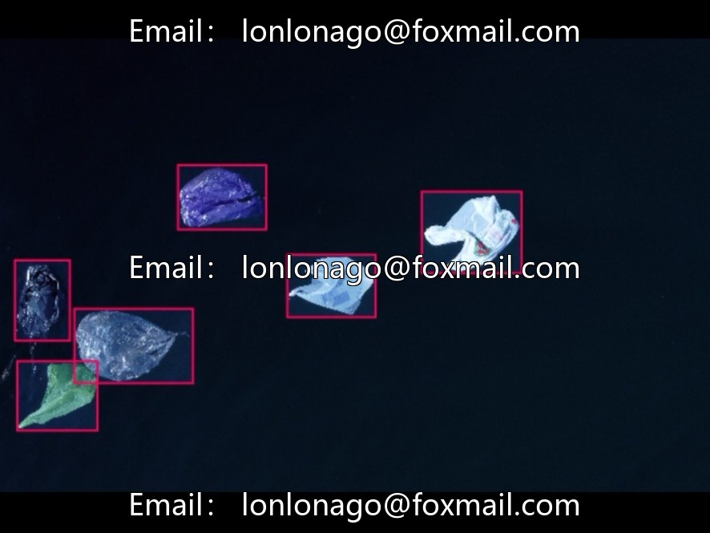
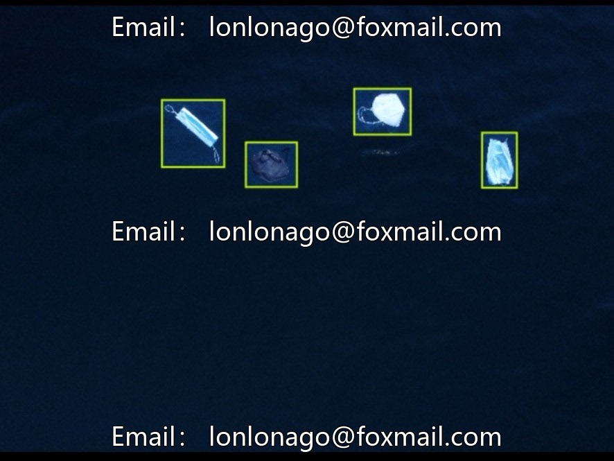
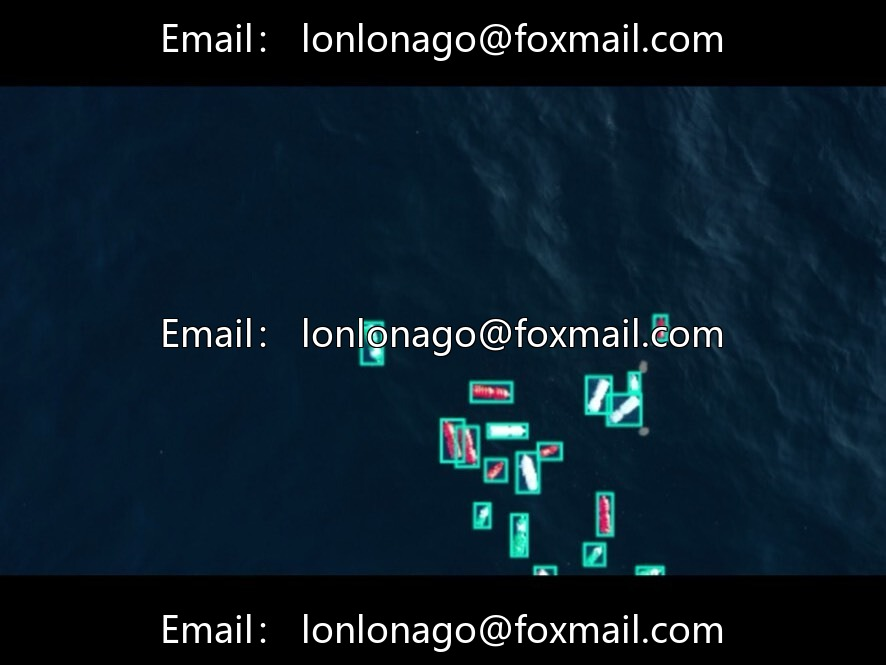
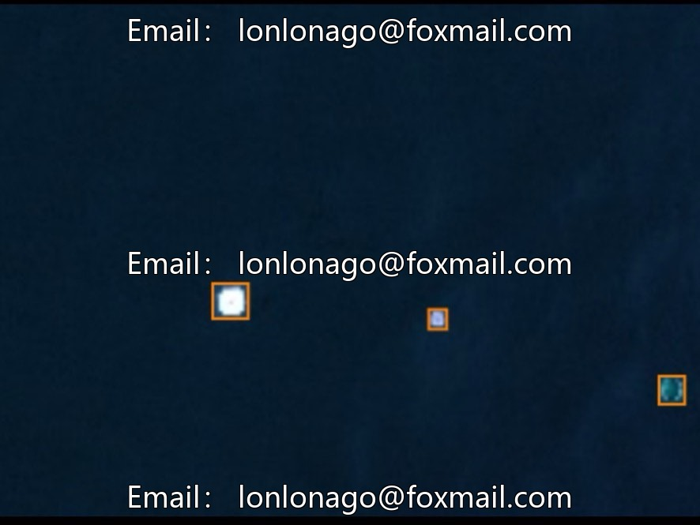
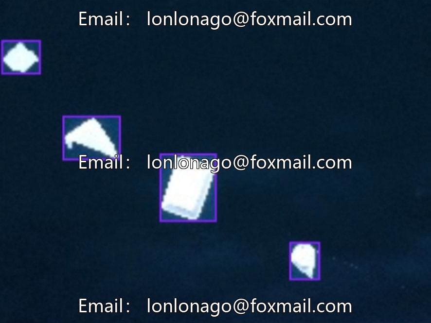

# Drone River/Ocean Floating Garbage Detection Dataset, Issue 10382

## Body

Drone-Based River/Ocean Floating Waste Detection Dataset, Issue 10382
Contains 2600 drone images of water surface captured and labeled in YOLO format, with five common floating waste categories: bottles, rigid plastics, masks, polystyrene, soft plastics.
Suitable for river inspection, marine monitoring, environmental research, etc., can be directly used for model training and environmental monitoring system development.

Virtual materials, once sold, are non-refundable.
Interested friends, click "I want" to proceed.

## Images

## Payment

Here is a pay link on Stripe ( https://buy.stripe.com/3cs8yP7sY87d0vu9AB ). Please contact me lonlonago@foxmail.com after funding $89, and I will send you a complete data files , thank you!

